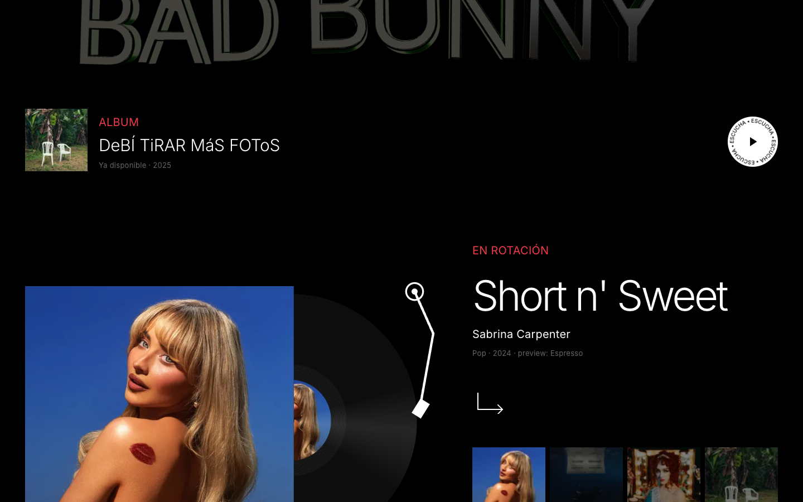
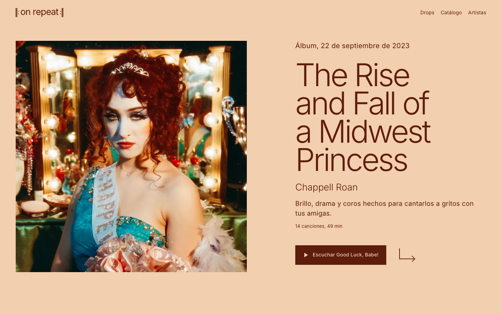
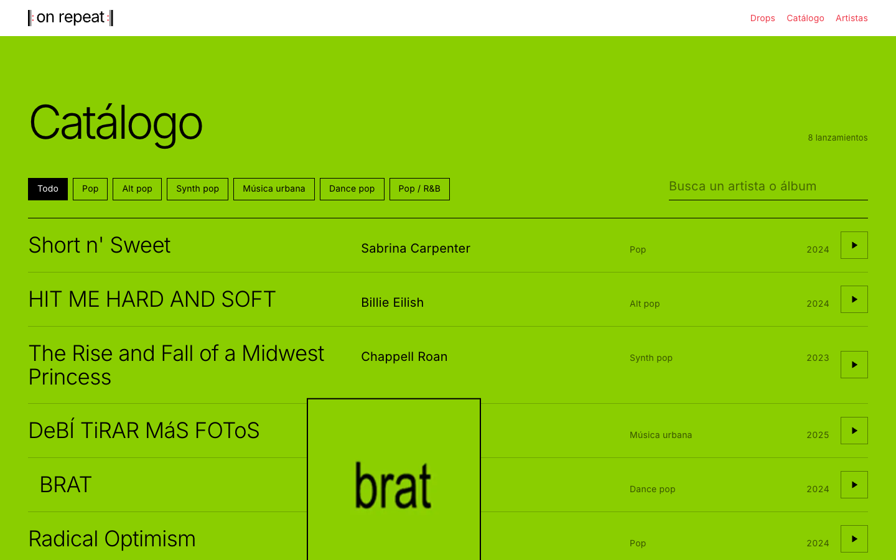

# On Repeat

A promo and catalog site for music releases, built as a front-end prototype. The home page opens on
the featured artist's name rendered as live chrome in WebGL, the catalog can be filtered and
previewed in place, and every album has its own page with a playable tracklist. There is no
backend: content lives in local data files and audio comes from the public iTunes 30-second
previews.

Live demo: https://zsamir015.github.io/on-repeat/


| | |
|---|---|
|  |  |
|  | |

## Stack

- Next.js 16 (App Router, static output), React 19, TypeScript
- Tailwind CSS 4, with the design tokens defined in `src/app/globals.css`
- Motion for UI animation, Lenis for smooth scrolling
- three.js through React Three Fiber and drei for the hero type

## Running it

Requires Node 20.9 or newer.

```bash
npm install
npm run dev        # http://localhost:3000
npm run build && npm run preview   # serves the static export in out/
```

The build is a static export (`out/`). `NEXT_PUBLIC_BASE_PATH` sets the sub-path the site is
served from and `NEXT_PUBLIC_SITE_URL` the absolute URL used for share metadata; both are unset
locally.

Checks:

```bash
npm run lint
npm run typecheck
```

## Deployment

`.github/workflows/pages.yml` lints, builds the export with the repository name as base path and
publishes `out/` to GitHub Pages on every push to `main`.

## Structure

```
src/
  app/
    page.tsx                 home
    album/[slug]/page.tsx    album pages, statically generated per release
    marca/page.tsx           brand guide (logo, color, type, voice)
  components/
    three/                   WebGL hero: chrome wordmark and studio lighting
    player/                  shared audio player, mini player bar
    brand/                   logo component and its generated geometry
    album/                   album page view
    motion/                  smooth scroll and viewport helpers
  content/
    releases.ts              catalog data: titles, colors, lead single, preview URL
    tracklists.json          per-album tracklists (generated, see below)
scripts/                     asset and data generators
public/
  covers/                    album artwork
  brand/                     logo SVGs
  fonts/                     typeface JSON for the 3D type
  og.png                     share card
docs/
  brand-guidelines.md
```

## How it works

**Hero type.** Each letter of the artist's name is a separate `Text3D` mesh, laid out from the glyph
advances in the typeface file so it can move independently: a staggered entrance, an idle wave,
lift toward the pointer, and a skew driven by scroll velocity from Lenis. The chrome look comes
entirely from the environment map: a set of `Lightformer` panels (sky, a thin horizon line, a
sweeping strip and two colored gels from the cover palette) baked offline, so no HDR file is
downloaded. The resting tilt places the horizon reflection across the letter faces.

**Audio.** `PlayerProvider` owns a single `HTMLAudioElement` for the whole site, so starting a
preview anywhere stops the previous one, and playback survives client-side navigation. iTunes
preview URLs send `Access-Control-Allow-Origin: *`, which lets the element run through a Web Audio
`AnalyserNode`. The low-frequency energy is published as a module-level `MotionValue`
(`audioLevel`), read every frame by the WebGL scene and by the logo dots without causing React
renders. The graph is created on the first play because browsers require a user gesture.

**Album color.** Each release carries a `color` and an `ink` sampled from its cover. The featured
section interpolates its background between albums as you scroll, the catalog section floods to
the hovered album's color, and album pages, the mini player and the logo on those pages take the
album's ink.

**Album pages.** Generated statically with `generateStaticParams`. Covers and titles are wrapped in
React's `<ViewTransition>` with a shared name, so navigating from the home page morphs the cover
(or the catalog title) into the album header without a client router library.

**Logo.** The name sits between the two musical repeat signs. `scripts/build-logo.mjs` outlines
the word from Inter Regular with manual kerning and writes the SVG assets, the favicon and the
geometry module that the React `<Logo>` component draws, so every use renders identical paths.

## Generated assets and data

The source fonts are not committed; fetch them before regenerating anything that depends on them.

```bash
npm run fonts        # Inter Light and Regular TTFs into scripts/
npm run logo         # public/brand/*.svg, src/app/icon.svg, logo geometry
npm run typeface     # public/fonts/inter-light.typeface.json for the 3D type
npm run tracklists   # src/content/tracklists.json from the iTunes lookup API
```

## Design system

Zero border radius, no shadows, one typeface (Inter). The brand palette is black, white and Ember
Red (`#EE3A49`); any other color on screen comes from the album being shown. Details in
`docs/brand-guidelines.md` and on the `/marca` page.

## Accessibility

Animations respect `prefers-reduced-motion` (the WebGL scene holds still, the record does not spin,
auto-advance stops). Hover effects are gated behind `(hover: hover) and (pointer: fine)`. The
full-screen menu closes on Escape, locks scroll and returns focus to its trigger.

## Content notice

This is a non-commercial prototype. The album artwork, titles and audio previews belong to their
artists and labels and are used here only as placeholder content to evaluate the design. They are
not covered by any license granted by this repository.
